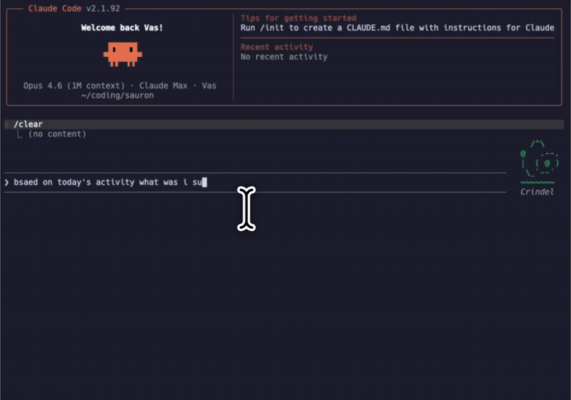

# Sauron

**Structured traces of human activity — OAT-style traces, but for how you actually work.**

A local-first macOS daemon that records your digital activity — clipboard, apps, and git commits — as structured intent → action → outcome traces, building a personal, queryable record of how you work. It doubles as the all-seeing eye for Claude Code and for [Valinor](https://github.com/sksareen/valinor): agents get awareness of what you're doing, plus an experience graph of what every agent has done before.

It watches your clipboard, tracks which apps you're using, detects git commits, classifies your work sessions, and stores everything in a local SQLite database with vector embeddings for semantic search. It also maintains an **agent experience graph** — a collective memory where agents log what worked, what failed, and what tools helped, so future agents don't repeat the same mistakes.

Sauron does not capture the screen and does not ask for Accessibility permission.

One binary. One database. 9 MCP tools. Zero cloud dependencies.

> **Roadmap:** segment the raw activity log into complete intent → action → outcome loops — including the deviations and frictions in between — as a training dataset for a personal behavioral model.

<p align="center">
  
</p>

---

## Quick Start

**From the DMG (recommended on a Mac):**

```bash
make dmg          # writes dist/Sauron.dmg; run this on macOS
open dist/Sauron.dmg
```

Drag **Sauron** to **Applications**, then open it once. That registers the LaunchAgent, starts the daemon, and links `~/go/bin/sauron`, which is the path Valinor calls.

**From source:**

```bash
go install github.com/sksareen/sauron/cmd/sauron@latest

# Set up LaunchAgent + MCP server + Claude Code hints + Valinor symlink
sauron install

# Start the daemon
sauron start

# Verify
sauron status
```

Restart Claude Code. It now has access to all 9 Sauron tools. Valinor's activity view reads the same daemon.

### Alternative install methods

**From a git checkout:**
```bash
git clone https://github.com/sksareen/sauron.git
cd sauron
make install-local
```

**One-liner (downloads pre-built binary):**
```bash
curl -fsSL https://raw.githubusercontent.com/sksareen/sauron/main/install.sh | bash
```

---

## What It Does

### 1. Watches Everything

The daemon runs in the background and captures:

| Signal | How | Frequency |
|--------|-----|-----------|
| **Clipboard** | `pbpaste` with source app (no window title) | Every 1s |
| **Active app** | `lsappinfo` (frontmost app + bundle id) | Every 5s |
| **Work sessions** | Classified from app switch patterns | Every 30s |
| **Git commits** | HEAD hash polling across `~/coding/*` repos | Every 10s |
| **Local servers** | `lsof` for listening TCP ports | On context query |

Session types: `deep_focus`, `exploration`, `communication`, `creative`, `admin`, `idle`. Focus score (0-100%) computed from app-switch frequency.

### 2. Remembers What Agents Learn

The **experience graph** is a structured log of every task an AI agent completes:

```
Task intent    →  "Fix authentication bug in login flow"
Approach       →  "Traced to expired JWT validation, updated token refresh logic"
Outcome        →  success
Tools used     →  [go, jwt-go, postgres]
Failure points →  ["initially tried session-based auth, didn't scale"]
Resolution     →  "Switched to stateless JWT with 24h expiry"
Tags           →  [auth, bugfix, security]
```

Before starting a new task, agents call `sauron_check_experience` to find similar past work. After completing a task, they call `sauron_log_experience` to record what happened. Over time, agents get smarter — they know which approaches work in your codebase and which don't.

All records are **automatically privacy-scrubbed** before storage: API keys, bearer tokens, emails, home directory paths, AWS keys, private key blocks, and database connection strings are redacted.

### 3. Valinor

[Valinor](https://github.com/sksareen/valinor) is a separate desktop hub. It is not a library inside this repo. Its activity view shells out to the Sauron binary at `~/go/bin/sauron` (override with `SAURON_BIN`) and expects:

| Command | What Valinor reads |
|---------|--------------------|
| `sauron status` | Plain text: `sauron: running (pid N)`, clipboard / activity / session counts, optional `live:` |
| `sauron context --json` | `dominant_app`, `session_type`, `focus_score`, `session_age_min`, `open_thread` |
| `sauron activity <hours> --json` | `app_breakdown`, `switches` |
| `sauron timeline --hours <hours> --json` | Array of `{timestamp, type, summary}` |
| `sauron clipboard <n> --json` | Array of `{content, source_app, captured_at}` |
| `sauron hints --json` | Array of `{id, source, label, status}` |
| `sauron reentry --json` | `{task, project, trace}` for the inferred open thread |
| `sauron task complete <id> --json` | Marks that thread done |
| `sauron hint stop <id> --json` | Stops a manual thread |
| `sauron experience recent <n> --json` | Experience records for the conversations view |

`sauron install` removes an old `com.sauron.capture` LaunchAgent if one is still installed, and symlinks the current binary to `~/go/bin/sauron`.

Screen capture is not part of this contract. Valinor's own screen grab, if you use it, is Valinor's `screencapture` call — Sauron does not invoke it.

---

## MCP Tools

Once installed, Claude Code gets 9 tools it can call on demand:

### Watcher

| Tool | Returns |
|------|---------|
| `sauron_context` | Current session type, focus score, dominant app, recent clipboard, local servers |
| `sauron_clipboard` | Last N clipboard items with source app + window title |
| `sauron_activity` | App usage breakdown with durations for last N hours |
| `sauron_search` | Full-text search (FTS5) across all clipboard history |
| `sauron_recall` | Semantic search over intent traces — "what was I doing when X happened?" |
| `sauron_timeline` | Fused chronological view of all event types in a time window |

### Experience Graph

| Tool | Does |
|------|------|
| `sauron_check_experience` | Semantic search over past agent experiences — find what worked, what failed, what to avoid |
| `sauron_log_experience` | Record a completed task with approach, outcome, tools, failures, resolution, tags |
| `sauron_experience_stats` | Total records, success/failure/partial breakdown |

---

## CLI Reference

```bash
# ── Daemon ─────────────────────────────────────
sauron start                      # start background daemon
sauron stop                       # stop daemon
sauron status                     # running? + capture stats

# ── Context & Activity ─────────────────────────
sauron context                    # current session summary
sauron context --brief            # one-line: "deep_focus | 90% | VS Code"
sauron clipboard [n]              # last n clipboard items (default: 10)
sauron activity [hours]           # app breakdown (default: 2h)
sauron search <query>             # full-text search across clipboard
sauron recall <query>             # semantic search over work history
sauron timeline [--hours 2]       # fused timeline of all events
sauron traces [--limit 10]        # recent intent traces (git commits, etc.)

# ── Experience Graph ───────────────────────────
sauron experience search <query>  # semantic search over past experiences
sauron experience stats           # graph statistics
sauron experience recent [n]      # most recent experiences

# ── Valinor open loops ─────────────────────────
sauron reentry --json             # inferred unfinished thread
sauron task complete <id> --json  # mark that thread done
sauron hints --json               # manual threads
sauron hint start <label>         # start a manual thread
sauron hint stop <id> --json      # stop a manual thread

# ── Setup ──────────────────────────────────────
sauron install                    # register LaunchAgent + MCP + CLAUDE.md
sauron uninstall                  # remove everything
sauron migrate-agentgraph         # import from standalone AgentGraph
sauron version                    # print version
```

All query commands support `--json` and `--md` output formats.

---

## Architecture

```
┌─────────────────────────────────────────────────────┐
│                    Your Mac                         │
│  clipboard · apps · windows · git repos · screens   │
└──────────────────────┬──────────────────────────────┘
                       │
          ┌────────────▼────────────┐
          │    Sauron Daemon        │
│  clipboard poll (1s)    │
│  activity poll  (5s)    │
│  session classify (30s) │
│  intent detect  (10s)   │
          └────────────┬────────────┘
                       │ writes
          ┌────────────▼────────────┐
          │  ~/.sauron/sauron.db    │
          │  ├─ clipboard_history   │
          │  │  └─ FTS5 index       │
          │  ├─ activity_log        │
│  ├─ context_sessions    │
│  ├─ intent_traces       │
          │  │  └─ embeddings       │
          │  └─ experiences         │
          │     └─ embeddings       │
          └──────┬──────────┬───────┘
                 │          │
        ┌────────▼──┐  ┌───▼────────┐
        │  CLI      │  │ MCP Server │
        │ (read)    │  │ (read/write)│
        └───────────┘  └───┬────────┘
                           │ stdio
                    ┌──────▼──────┐
                    │ Claude Code │
                    │  9 tools    │
                    └─────────────┘
```

- **Daemon** owns all writes to the database
- **CLI** is read-only — safe to run anytime
- **MCP server** is read-write (experience logging needs writes)
- **SQLite WAL mode** for concurrent read/write access
- **Vector embeddings** stored as float32 BLOBs — no separate vector DB
- **Semantic search** uses cosine similarity over `text-embedding-3-small` embeddings via OpenRouter

---

## Configuration

### Required

Nothing. Sauron works with zero configuration out of the box.

### Optional

**Semantic search** — set an OpenRouter API key to enable vector-based search for `recall` and `check_experience`. Without it, both fall back to text matching (LIKE queries).

```bash
export OPENROUTER_API_KEY=sk-or-...
```

Add to your `~/.zshrc` or `~/.bashrc` to persist.

---

## Data Storage

Everything stays local. No cloud, no telemetry, no network calls except optional embedding generation.

```
~/.sauron/
├── sauron.db                # SQLite database (all tables)
├── sauron.pid               # daemon process ID
└── daemon.log               # daemon output log
```

### Database tables

| Table | Records | Purpose |
|-------|---------|---------|
| `clipboard_history` | Every clipboard change | Content + source app + window title |
| `clipboard_fts` | FTS5 virtual table | Full-text search over clipboard |
| `activity_log` | Every app switch | App name, duration, window title |
| `context_sessions` | Every 30s | Session type, focus score, dominant app |
| `intent_traces` | Git commits, etc. | Outcome + activity context + embeddings |
| `experiences` | Agent task logs | Intent, approach, outcome, tools, failures + embeddings |

---

## Migrating from Other Tools

### From AgentGraph

If you used the standalone AgentGraph MCP server:

```bash
sauron migrate-agentgraph
```

Copies all records from `~/.agentgraph/experiences.db`, converting Float64 embeddings to Float32. Then remove the `agentgraph` entry from `~/.claude.json`.

### From Sakshi

Sauron's watcher is the same codebase as Sakshi with an identical schema:

```bash
sakshi stop && sakshi uninstall
cp ~/.sakshi/sakshi.db ~/.sauron/sauron.db
sauron install && sauron start
```

---

## How `sauron install` Works

The install command does four things:

1. **LaunchAgent** — writes `~/Library/LaunchAgents/com.sauron.daemon.plist` so the daemon starts on login and auto-restarts if killed
2. **MCP registration** — adds a `sauron` entry to `~/.claude.json` pointing to the binary with `mcp` argument (stdio transport)
3. **CLAUDE.md hint** — appends a block to `~/.claude/CLAUDE.md` telling Claude Code what tools are available and when to use them
4. **Valinor symlink** — points `~/go/bin/sauron` at this binary, and removes a leftover `com.sauron.capture` LaunchAgent if one exists

`sauron uninstall` reverses all three steps.

---

## Requirements

- **macOS** (uses `lsappinfo`, `pbpaste`, `lsof`)
- **Go 1.23+** to build from source
- Optional: `OPENROUTER_API_KEY` for semantic search

## DMG

`make dmg` (or `./package.sh`) cross-compiles a darwin binary, lays out `dist/Sauron.app`, and on a Mac wraps it in `dist/Sauron.dmg` with an Applications alias.

```bash
make dmg
open dist/Sauron.dmg
```

Drag Sauron to Applications and open it once. The app runs `sauron install` and `sauron start`.

Signing and notarization use the hooks already in `package.sh`. They are optional:

```bash
# Ad-hoc signature (default when codesign is available). Fine for a local copy.
./package.sh

# Developer ID, then notarize with a notarytool keychain profile you created.
CODESIGN_IDENTITY="Developer ID Application: Your Name (TEAMID)" \
NOTARY_KEYCHAIN_PROFILE=sauron-notary \
./package.sh
```

`packaging/entitlements.plist` only allows the unsigned executable memory Go needs under Hardened Runtime. It does not request screen recording or Accessibility.

A downloaded DMG is still quarantined until it is notarized. This repository cannot notarize without your Apple credentials. Without them, right-click the app and choose Open the first time, or sign and notarize with the variables above.

On Linux, `./package.sh` still stages `dist/Sauron.app` (arm64 if `lipo` is missing) and skips the DMG, because `hdiutil` is macOS-only. `--stage-only` always skips the DMG.

---

## License

MIT
